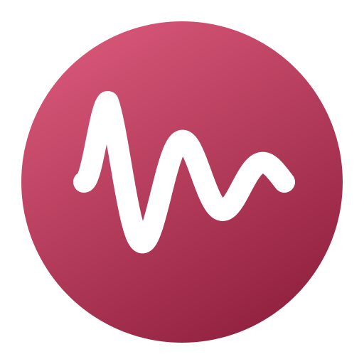

  <picture>
    <source media="(prefers-color-scheme: dark)" srcset="assets/onefold-lockup-on-dark.svg">
    
  </picture>

<b>One sheet, one fold.</b> Open desktop tools that do one thing well. 
Local first. No account. Open source.

---

| | Project | What it is | Status |
|---|---|---|---|
|  | [**StudioCraft**](https://github.com/ONEFOLD-LABS/StudioCraft) | Digital audio workstation | In development |

### What it stands for

- **Local first.** Works without a network; cloud features are optional.
- **No account.** Nothing to sign up for.
- **Open source.** Permissive licences only.
- **Native.** Pure Rust, one interface for Linux, Windows, macOS, FreeBSD and the web.

Logo, colours and type: [ONEFOLD-LABS/brand](https://github.com/ONEFOLD-LABS/brand).
