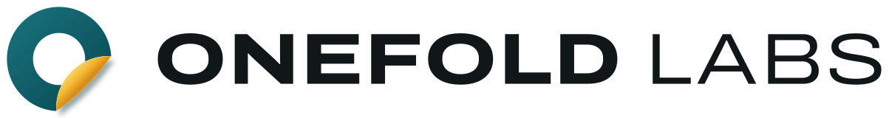
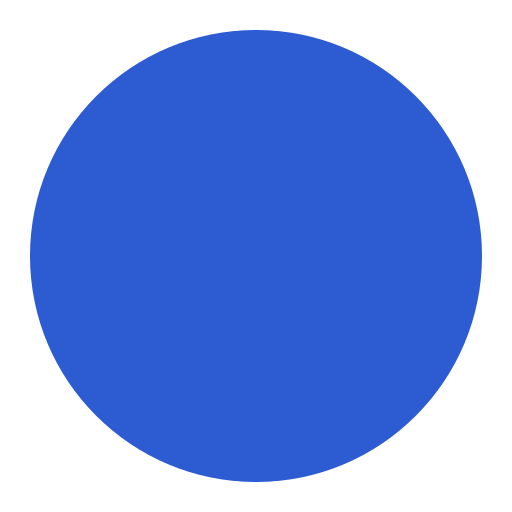
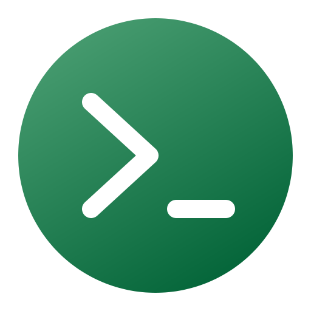
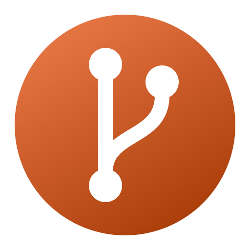
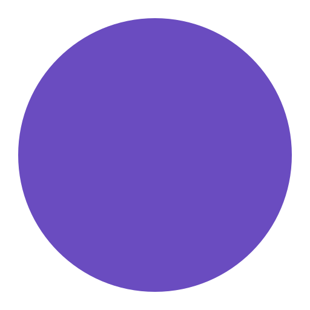
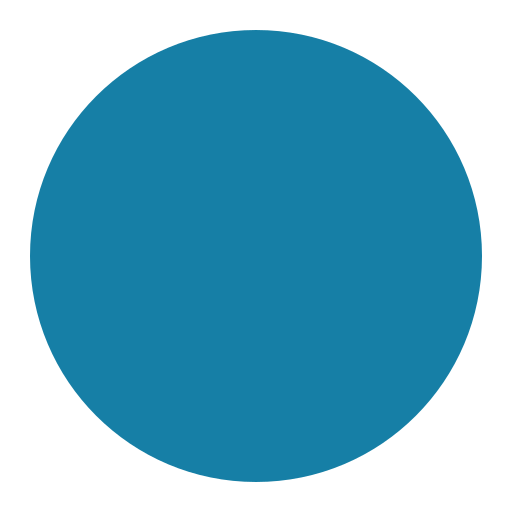
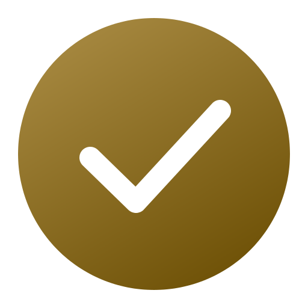

  <picture>
    <source media="(prefers-color-scheme: dark)" srcset="assets/onefold-lockup-on-dark.svg">
    
  </picture>

<b>One sheet, one fold.</b> Open desktop tools that do one thing well. 
Local first. No account. Open source.

---

| | Project | What it is | Status |
|---|---|---|---|
|  | [**StudioCraft**](https://github.com/ONEFOLD-LABS/StudioCraft) | Digital audio workstation | In development |
|  | **CodeCraft** | Code editor and development environment | Planned |
|  | **TermCraft** | Terminal emulator | Planned |
|  | **GitCraft** | Git client | Planned |
|  | **DataCraft** | Database and SQL client | Planned |
|  | **CloudCraft** | Container and infrastructure management | Planned |
|  | **IssueCraft** | Issue tracking and project management | Planned |

Names of planned projects are provisional.

### What every project shares

- **Local first.** Works without a network; cloud features are optional.
- **No account.** Nothing to sign up for.
- **Open source.** Permissive licences only.
- **Native.** Pure Rust, one interface for Linux, Windows, macOS, FreeBSD and the web.

Logo, colours and type: [ONEFOLD-LABS/brand](https://github.com/ONEFOLD-LABS/brand).
